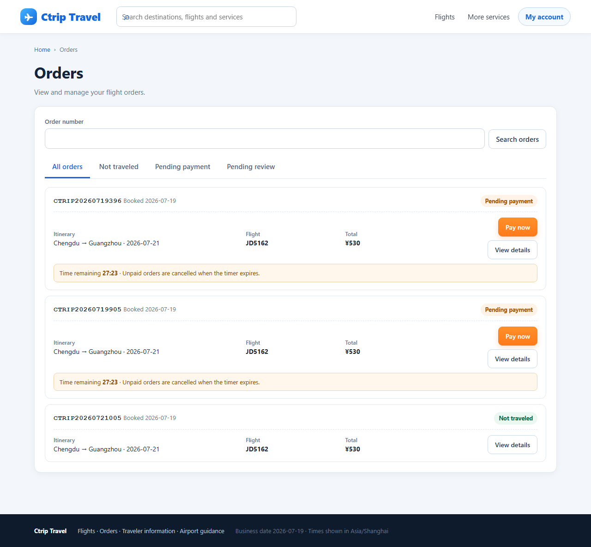
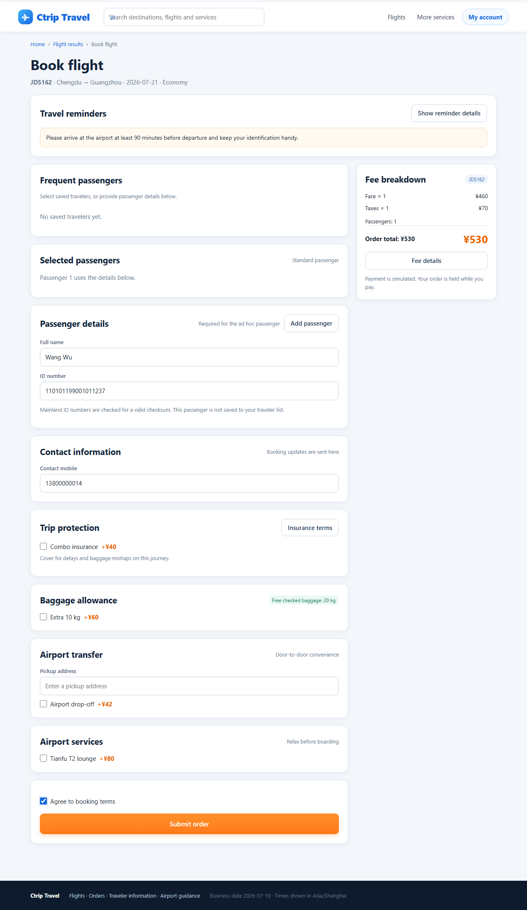
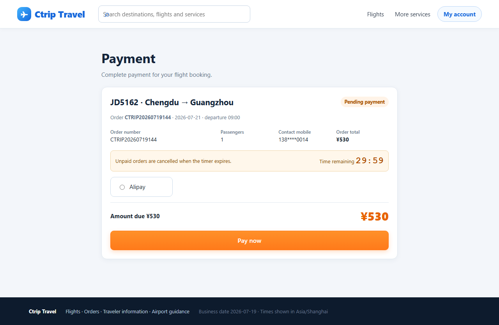
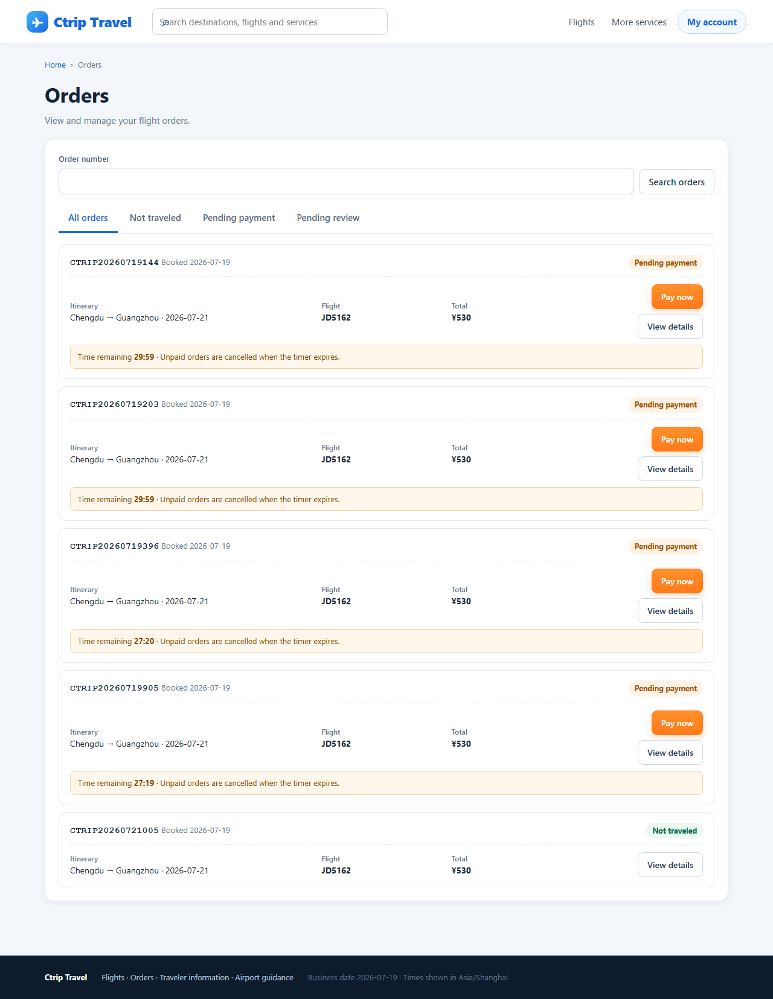

# REQ-3.8 / REQ-4.1 Test: One booking creates two orders

## Description

A double-click on **Submit order** creates two pending orders for a single completed booking form.

## Requirement: Expected Output

REQ-3.8 describes one unpaid booking opening at the cashier. A second activation of the same submission while the first is pending should leave one order for that booking. REQ-4.1 provides the order list where the two distinct order numbers can be observed. [Ctrip requirements](../../requirements/requirements.yaml)

## Test description

Black-box timing test with Playwright. Use a local course instance and sign in as `ctrip_voucher_pending@example.com` with the course fixture password `Travel1234`.

1. Record the existing order numbers from **My account** → **Orders**.
2. From **Home**, search Chengdu to Guangzhou for July 21 and book JD5162 Economy.
3. Fill Wang Wu, ID `110101199001011237` and mobile `13800000014`, then accept the booking terms.
4. Double-click **Submit order** before the first submission completes. The script delays forwarding each original booking request by 500 milliseconds and waits for the in-flight submissions to finish.
5. Open **Orders** again and count newly added order numbers.

The baseline submits once and verifies the cashier. This case exercises repeated activation during an in-flight request and verifies the number of created records. [Baseline REQ-3.8](../baseline/REQ-3.8.spec.ts) · [Baseline REQ-4.1](../baseline/REQ-4.1.spec.ts)

Run from the repository root after setting `$ctripUrl` to the launcher URL. [Playwright 1.57.0 and Chromium setup](README.md#run-the-scripts) · [Test script](order-lifecycle.cjs)

```powershell
node applications/ctrip/test/team-08/order-lifecycle.cjs $ctripUrl duplicate-submit
```

## Observed Output

The cashier opens, and **Orders** contains two new order numbers instead of one. Both orders are left in the local test instance.

### Screenshots

**1. The order list before the booking attempt**



**2. The completed form before double-clicking Submit order**



**3. The cashier opens for one newly created order**



**4. The order list now contains two new pending orders**


