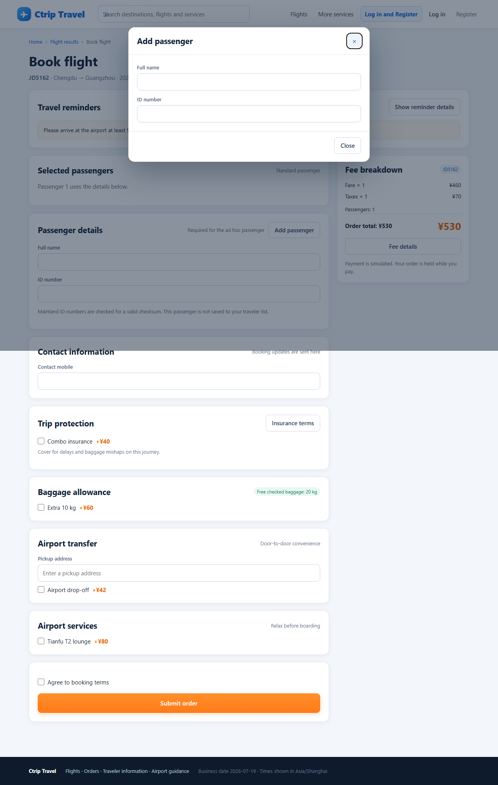
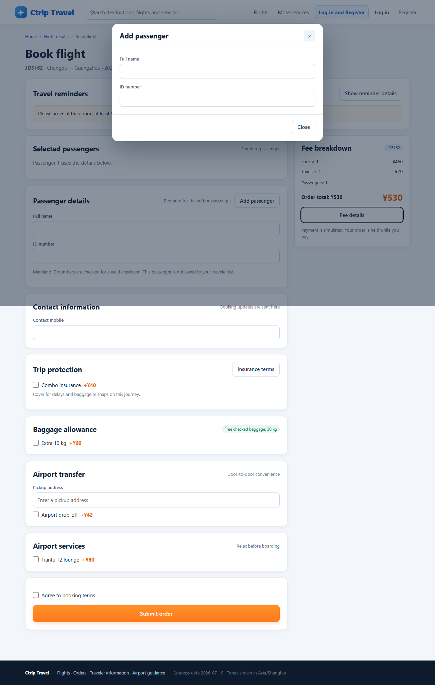

# REQ-3.4 Test: Keyboard focus escapes the passenger dialog

## Description

Reverse tabbing from the start of **Add passenger** puts focus on the booking form behind the still-open modal.

## Requirement: Expected Output

REQ-3.4 requires an **Add passenger** dialog with named passenger fields. The implementation exposes this as a modal. The expected keyboard behavior follows the W3C modal dialog pattern, which keeps Tab and Shift+Tab within the dialog while it is open. The course requirement does not explicitly detail the tab sequence. [Ctrip requirements](../../requirements/requirements.yaml) · [W3C modal dialog pattern](https://www.w3.org/WAI/ARIA/apg/patterns/dialog-modal/)

## Test description

Black-box Playwright test. Start signed out and search Chengdu to Guangzhou for July 21. Open flight JD5162's Economy fare and click **Book**, then click **Add passenger**. Focus **Full name** in the dialog and press Shift+Tab once to reach **Close dialog**. Press Shift+Tab again and check that focus stays in the open dialog.

The REQ-3.4 baseline verifies that the dialog and both fields are visible. This case checks keyboard behavior after the dialog opens. The earlier Team 08 booking cases check contact feedback placement and payment expiry. [Baseline REQ-3.4](../baseline/REQ-3.4.spec.ts)

Run `node applications/ctrip/test/team-08/navigation-accessibility.cjs $ctripUrl passenger-dialog-focus` from the repository root. [Test script](navigation-accessibility.cjs) · [Setup](README.md#run-the-scripts)

## Observed Output

The second Shift+Tab moves focus to **Fee details** in the background. **Add passenger** stays open.

### Screenshots

**1. The Add passenger modal opens with both passenger fields**

**2. The first Shift+Tab focuses Close dialog**

**3. The second Shift+Tab moves focus behind the still-open dialog**

