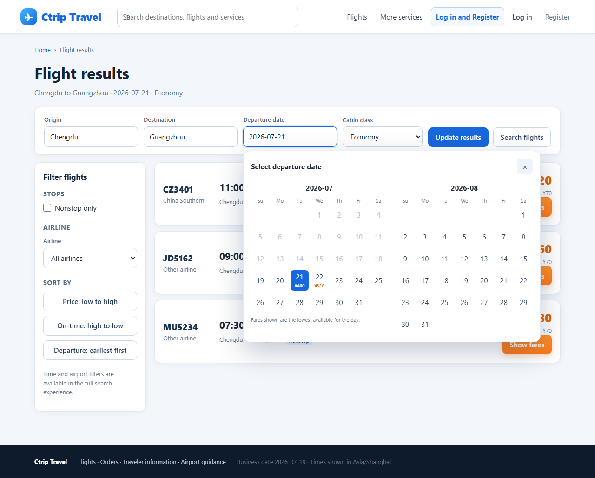
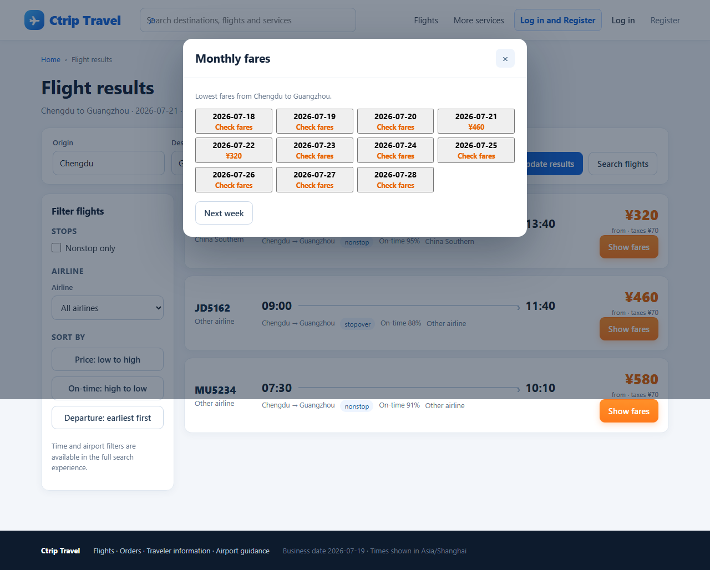
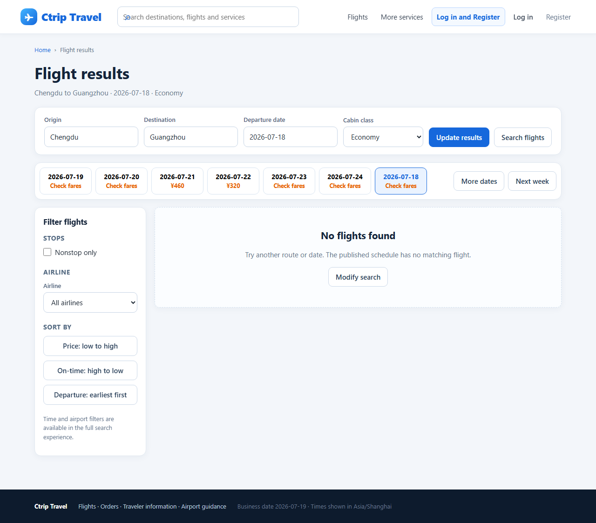

# REQ-2.3 / REQ-2.8 Test: Selecting a past departure in Monthly fares

## Description

Monthly fares allows a search for a departure before the course clock.

## Requirement: Expected Output

REQ-2.3 disables July 18 as a departure under the July 19 clock. REQ-2.8 offers Monthly fares from the results page. Both pickers on that page select the same departure date, so both should enforce that date boundary. [Ctrip requirements](../../requirements/requirements.yaml)

## Test description

**Black-box design.** Start signed out under the July 19 course clock. Use July 18 as the past-date boundary and compare the two departure selectors on the same route and results page.

1. Search Chengdu to Guangzhou for **2026-07-21**.
2. Open **Departure date** on the results page and verify that **2026-07-18** is disabled.
3. Close the departure picker and open **More dates**.
4. If **2026-07-18** is available in **Monthly fares**, click it and check the date in the results URL.

The REQ-2.8 baseline opens **Monthly fares** and checks July 22. The REQ-2.3 baseline checks July 18 in the homepage calendar. This case compares July 18 across the two selectors on the results page. [Baseline REQ-2.3](../baseline/REQ-2.3.spec.ts) · [Baseline REQ-2.8](../baseline/REQ-2.8.spec.ts)

Run from the repository root after setting `$ctripUrl` to the launcher URL. [Playwright 1.57.0 and Chromium setup](README.md#run-the-scripts) · [Test script](journey-dates.cjs)

```powershell
node applications/ctrip/test/team-08/journey-dates.cjs $ctripUrl past-monthly-fare
```

## Observed Output

The results departure calendar disables July 18. Monthly fares accepts it and changes the results URL to July 18.

### Screenshots

**1. The results departure calendar disables July 18**



**2. Monthly fares offers July 18**



**3. The results show July 18 after it was selected through Monthly fares**


