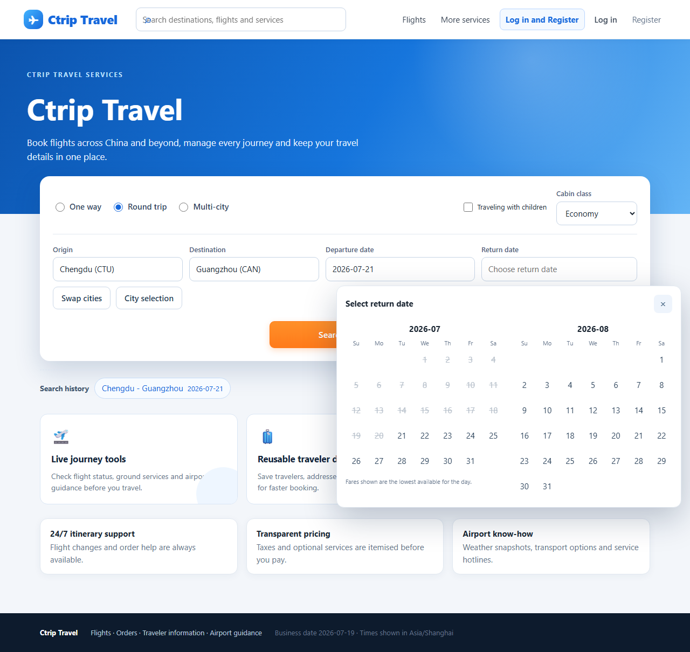
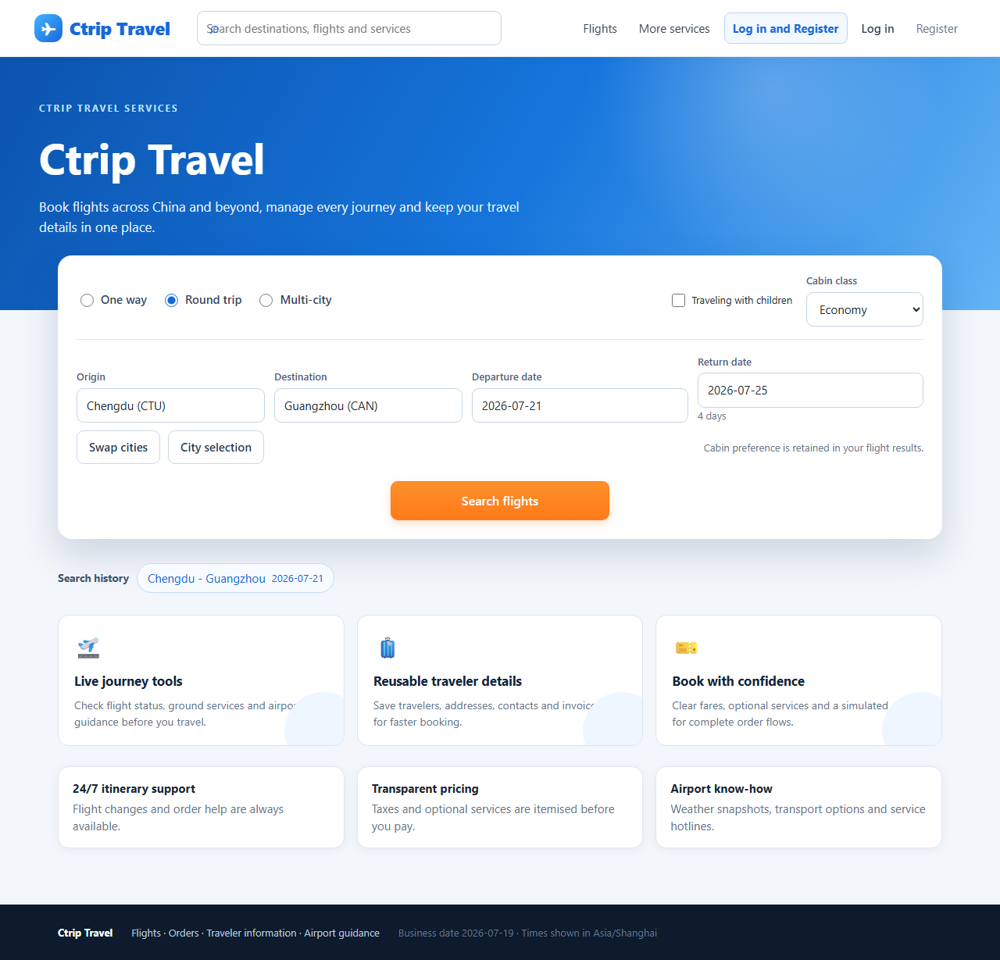

# REQ-2.3 Test: Changing departure invalidates an earlier return

## Description

The round-trip form keeps an earlier return after the departure moves forward.

## Requirement: Expected Output

REQ-2.3 disallows a return before departure. Changing the departure should clear or otherwise invalidate the earlier return. [Ctrip requirements](../../requirements/requirements.yaml)

## Test description

**Black-box design.** Start signed out under the course clock. Choose a valid four-day trip, then move the departure one day past the return to test the boundary after both fields have been set.

1. On the homepage, select **2026-07-21** as the departure.
2. Click **Add return** and select **2026-07-25**. Verify that the return field shows that date.
3. Open **Departure date** again and select **2026-07-26**.
4. Read both date fields and check that the form has cleared or corrected the earlier return.

The baseline checks an earlier date is disabled when selecting a return. This test first makes a valid selection, then changes the departure. [Baseline REQ-2.3](../baseline/REQ-2.3.spec.ts)

Run from the repository root after setting `$ctripUrl` to the launcher URL. [Playwright 1.57.0 and Chromium setup](README.md#run-the-scripts) · [Test script](journey-dates.cjs)

```powershell
node applications/ctrip/test/team-08/journey-dates.cjs $ctripUrl earlier-return
```

## Observed Output

Departure reads July 26 and return remains July 25.

### Screenshots

**1. The return calendar opens after choosing July 21 as departure**



**2. The form shows a valid July 21–25 round trip**



**3. After changing departure to July 26, the form still shows July 25 as return and displays −1 days**


